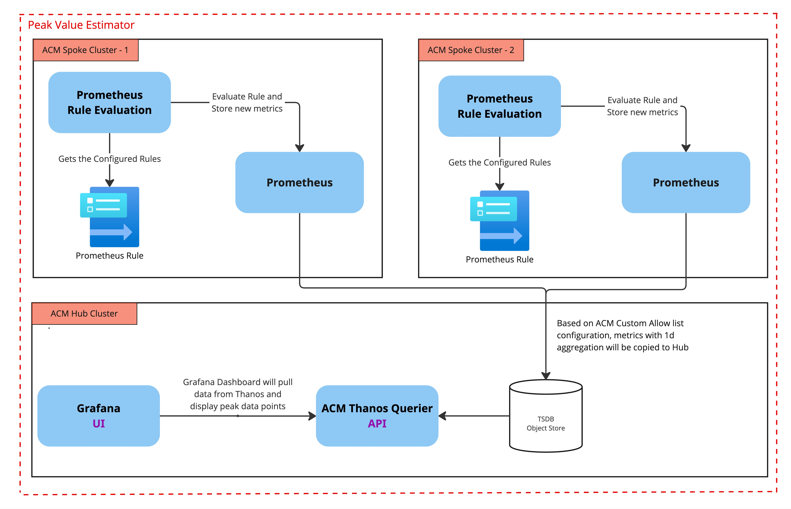
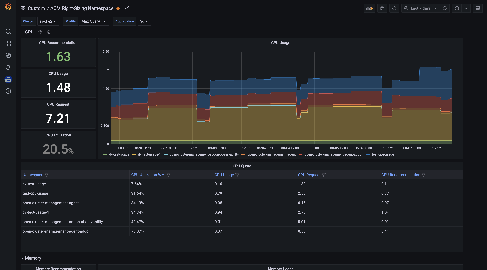

> [!WARNING]
> **This repository is no longer actively maintained.** Right Sizing is now Generally Available (GA) starting with ACM 2.16 and is enabled by default with the observability stack. Please refer to the [official documentation](https://docs.redhat.com/en/documentation/red_hat_advanced_cluster_management_for_kubernetes/2.17/html/observability/observing-environments-intro#right-size-intro) for the recommended setup. The content in this repository is retained for historical reference only.

# Right Sizing Recommendations in Red Hat Advanced Cluster Management for OpenShift

Right Sizing in Red Hat Advanced Cluster Management for OpenShift (RHACM) provides actionable CPU and memory recommendations at the **Namespace** and **Virtualization VM** levels, helping cluster administrators optimize resource requests and utilization across their managed fleet.

**Right Sizing is Generally Available (GA) starting with ACM 2.16** and is enabled by default with the observability stack.

# Getting Started

For the recommended setup and usage, refer to the official Red Hat documentation:

* **[Right Sizing Recommendations (Official Documentation)](https://docs.redhat.com/en/documentation/red_hat_advanced_cluster_management_for_kubernetes/2.17/html/observability/observing-environments-intro#right-size-intro)** -- GA documentation for enabling and using right-sizing with the observability stack.

* **[Right Sizing with MCOA and Perses Dashboards (Developer Preview)](https://developers.redhat.com/articles/2026/06/22/right-sizing-recommendations-mcoa-and-perses-dashboards)** -- Developer Preview in ACM 2.17. Uses ManifestWork and Perses dashboards for a simplified setup via a single annotation. Targeted for GA in an upcoming release.

# Approaches

| | GA (ACM 2.16+) | Developer Preview (ACM 2.17) |
|---|---|---|
| **Delivery** | ACM Policy / ConfigurationPolicy | ManifestWork via MCOA |
| **Dashboards** | Grafana | Perses (embedded in ACM console) |
| **Setup** | Enabled by default with observability stack | Single annotation on MultiClusterObservability CR |
| **Status** | Generally Available | Developer Preview |

# Architecture Overview (Policy-based Approach)

The ACM Right Sizing recommendations are calculated with the following approach:
* **Prometheus Recording Rule (PrometheusRule)**: CPU and memory capacity/usage are calculated at the namespace and cluster levels using PrometheusRule. This rule aggregates data over periods of up to 1 day and is evaluated on each managed cluster.
* **Data Forwarding**: Records for one day are forwarded to the RHACM Hub using the [observability-metrics-custom-allowlist](https://docs.redhat.com/en/documentation/red_hat_advanced_cluster_management_for_kubernetes/2.17/html-single/observability/index#creating-custom-rules).
* **Grafana Aggregation**: Grafana calculates aggregated data over multiple time periods, including 5, 10, 30, 60, 90, and 120 days, at runtime.

# Right Sizing Solution in Action

# Variants of Right Sizing

Right Sizing supports two variants at Namespace and Virtualization VM levels. In the future, Right Sizing at the **workload** level will also be supported.

## ~~Legacy Installation Steps (Policy-based Approach)~~

> **These installation guides are outdated.** Right Sizing is now GA and enabled by default with the observability stack starting with ACM 2.16. Please use the [official documentation](https://docs.redhat.com/en/documentation/red_hat_advanced_cluster_management_for_kubernetes/2.17/html/observability/observing-environments-intro#right-size-intro) instead. The links below are retained for historical reference only.

1. ~~[Namespace Level](./docs/rs-namespace/README.md)~~
2. ~~[Virtualization VM Level](./docs/rs-virtualization/README.md)~~

# Disclaimer

* Prometheus rules are based on **Cluster Name**, NOT Cluster ID.
* CPU/Memory requests, usage, and recommendations show the maximum/peak values over the selected number of aggregated days.
* After installing the ACM Right Sizing component, administrators will need to wait for data to be collected as historical data points are not back-filled.
